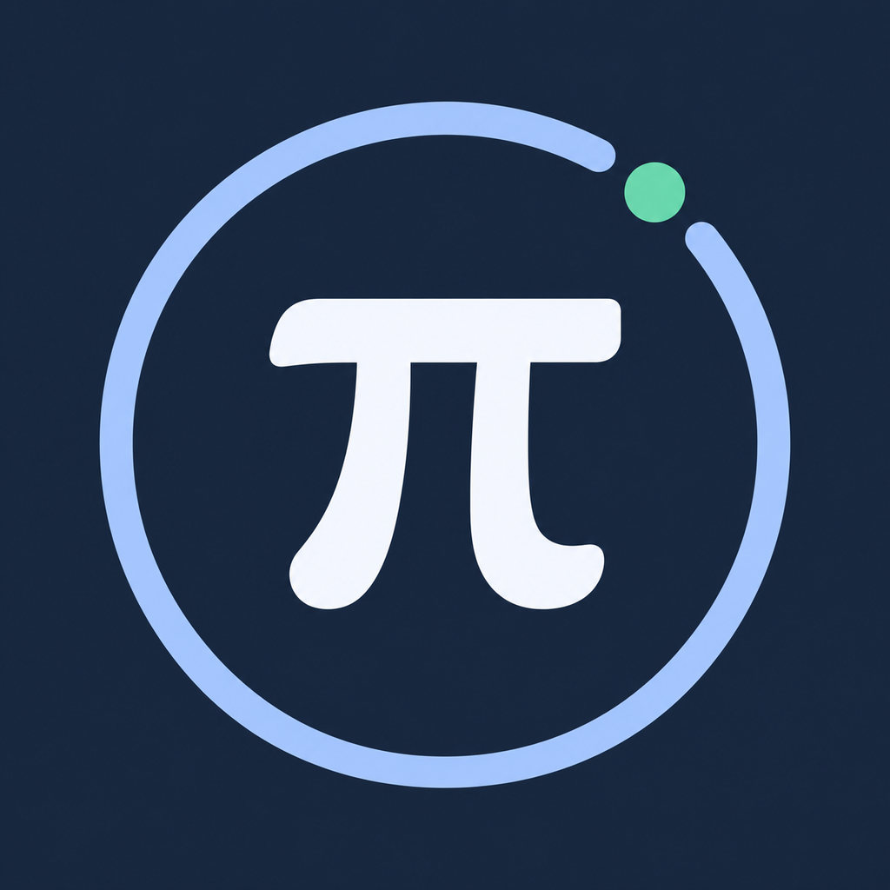
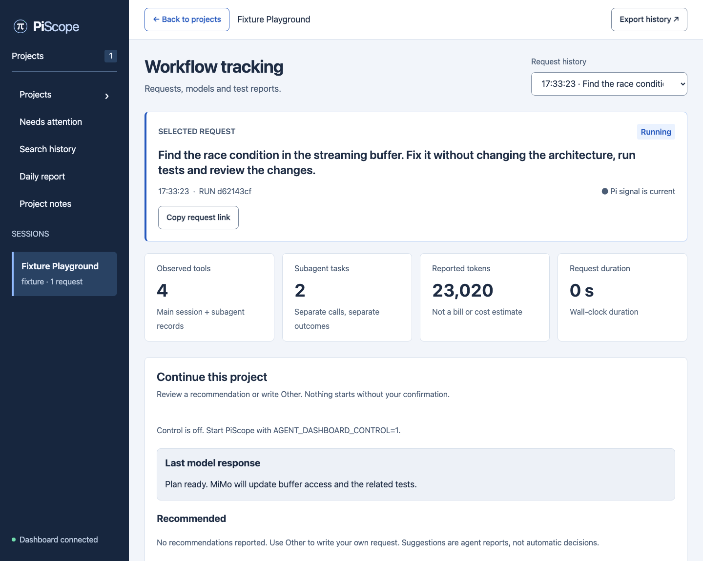

# PiScope

**Pi projelerinde neler olduğunu gör, kaldığın yerden devam et.**

PiScope, [Pi coding agent](https://pi.dev) kullananlar için bir takip ekranıdır.
Projelerini, son isteklerini, model yanıtlarını ve çalışan agent'ları tek tarayıcı
penceresinde gösterir. İstersen Tailscale ile telefonundan da bakabilirsin.

[English](README.md) · Türkçe rehber



*Görüntü sentetik test verisidir. Gerçek kullanıcı istekleri veya ölçülmüş model performansı içermez.*

Sen Pi'de normal şekilde çalışmaya devam edersin. PiScope, Pi'nin bildirdiği
çalışmayı kaydeder ve ekranda gösterir. Projeleri görüntülemek model çağrısı
başlatmaz. Yeni istek göndermek ve günlük rapor üretmek isteğe bağlıdır, açık
onayını gerektirir ve mevcut Pi modelinin izinlerini ve kotasını kullanır.

## Ne işime yarar?

| Yapmak istediğin | Kullanacağın bölüm |
|---|---|
| Nerede kaldığını görmek | **Projects**, son isteği, yanıtı ve bildirilmiş sonraki adımı gösterir. |
| Dikkat bekleyen işleri bulmak | **Needs attention**, okunmamış yanıtları, güncel hataları ve bildirilmiş engelleri toplar. |
| Eski bir çalışmayı bulmak | **Search history**, saklanan istek ve yanıtlarda arama yapar; proje, model, sonuç ve tarih filtreleri sunar. |
| Sık kullandığın projeleri önde tutmak | **Pin** ile sabitle; **Cards / Compact list** ile görünümü seç. Tercihler bu tarayıcıda kalır. |
| Belirli bir isteğe geri dönmek | İsteği açıp **Copy request link** ile bağlantısını kopyala. Yenileme ve geri/ileri gezinme desteklenir. |
| Yanıtı okumak veya kodu almak | Yanıtlar Markdown, tablolar ve **Copy code** düğmeli kod bloklarıyla gösterilir. |
| Gün içinde yaptıklarını özetlemek | **Daily report**, izlenen projeler için onaylı tek bir günlük rapor üretir. |
| Dashboard'dan yeni iş göndermek | **Continue this project**, öneriyi incelemeni veya kendi isteğini yazmanı sağlar. |
| Mevcut görev notlarını kullanmak | **Project notes**, Terminal Todos notlarını okuyup birini onaylı Pi isteğine dönüştürmene yardımcı olur. |

**İstek**, Pi'ye verdiğin görevdir. **Oturum**, açık bir Pi konuşmasıdır.
Aynı projede birkaç oturum açıksa hepsi tek proje kartında toplanır.

**Yanıtın bitmesi, projenin tamamlandığı veya testlerin geçtiği anlamına gelmez.**
Planlar agent'ın bildirimidir; sonucu bilinmeyen işler tamamlanmış sayılmaz.

## Başlangıç

**Node.js 22 veya üzeri**, tarayıcı ve mevcut bir Pi kurulumu gerekir.
`npm install` veya ayrı bir arayüz derleme adımı yoktur.

### 1. PiScope'u başlat

```bash
git clone https://github.com/TemelGunaydin/PiScope.git
cd PiScope
npm start
```

Bu terminal açık kalsın. **İkinci terminalde**, PiScope klasörünü açıp çalıştır:

```bash
npm run open
```

Tarayıcı açılır ve çalışan PiScope ile eşleşir. Eşleştirme, bu tarayıcıya yerel
PiScope kayıtlarını görme izni vermektir. `npm start` çıktısındaki özel
eşleştirme bağlantısını elle açman da yeterlidir.

Sonraki ziyaretlerde [http://127.0.0.1:7331](http://127.0.0.1:7331) adresini kullan.
`npm run open` yalnızca tarayıcıyı açar; `npm start` çalışmaya devam etmelidir.
Eşleştirme bağlantılarını parola gibi koru ve paylaşma.

### 2. Bir projeyi bağla

İzlemek istediğin her proje için, **PiScope klasöründen** bir kez çalıştır.
Örnek yolu, kendi projenin tam klasör yoluyla değiştir:

```bash
npm run install:pi -- "/tam/yol/projen"
```

Kurulum, projeye `.pi/extensions/agent-dashboard/` altında izleme eklentisini
ekler. Projenin dili önemli değildir; hedef projede `package.json` bulunması
gerekmez. Aynı Pi oturumunda eklentinin tek kopyasını kullan; hem genel hem
proje dizininden iki kez yükleme.

### 3. Pi'yi aç ve çalışmaya başla

Başka bir terminalde kendi projenin klasörünü aç:

```bash
cd /tam/yol/projen
pi
```

Pi içinde:

```text
/reload
/dashboard-status
```

**`PiScope: connected`** mesajını gördükten sonra normal bir görev ver. Çalışma
kaydedilince proje dashboard'da görünür. Diğer projeler için 2. ve 3. adımları
tekrarla. Pi komutları tanımıyorsa o projedeki Pi'yi kapatıp yeniden aç.

## Günlük kullanım

- **Projects** ile başla. Projenin son isteğini açarak yanıtını, modellerini,
  araçlarını ve hareketlerini gör. **Back to projects** ile filtrelerine dön.
- **Needs attention**, okunmamış yanıtları ve güncel sorunları gösterir. Tam
  ilgili yanıtı açmak okunmamış işaretini temizler. Hatayı okumak onu çözmez.
- Eski işler için **Search history** kullan. Örneğin `giriş` sözcüğünü ara,
  projeyi seç ve tarih aralığını daralt. Tarihler ekranda belirtilen saat dilimini
  kullanır. Arama, oturum başına en fazla 30 saklanan isteği ve yakalanmış metni
  kapsar; silinmiş veya hiç kaydedilmemiş metin geri getirilemez.
- **Copy request link** ile isteğe yer işareti oluştur. Bağlantı eşleştirme
  parolasını içermez; başka tarayıcının ayrıca eşleşmesi gerekir. Süresi dolmuş
  bağlantı farklı bir isteği açmak yerine kaydın bulunamadığını gösterir.
- Sık kullandığın projeleri **Pin** ile sabitle. **Compact list**, aynı ekranda
  daha fazla proje gösterir. Sabitlenenler üstte, projeler kendi gruplarında
  ad sırasındadır; canlı güncellemelerde yer değiştirmezler.
- Yanıtları Markdown biçiminde oku, kod bloklarını **Copy code** ile kopyala.
  HTML metin olarak kalır; dış görseller kendiliğinden yüklenmez.

Okunmamış işaretleri, sabitlemeler ve görünüm tercihi bu tarayıcıya aittir.
Bilgisayarınla telefonun farklı tercihlere sahip olabilir. Arayüz İngilizcedir;
proje adların, isteklerin ve yanıtların kendi dilinde kalır.

Kartlardaki sonraki adım, agent'ın bildirdiği plana dayanır. Plan raporlaması için
[proje hafızası](docs/PROJECTS.md) ve [workflow profilleri](docs/WORKFLOWS.md)
rehberlerine bakabilirsin. Model ve araç hareketleri plan bildirimi olmadan da
izlenir.

## İsteğe bağlı: dashboard'dan yeni görev gönder

Bunu, açık ve boşta olan bir Pi oturumuna istek göndermek istiyorsan etkinleştir.
Üç ayrı izin gerekir:

1. PiScope'u kontrol açık şekilde yeniden başlat. Kullandığın Tailscale ve not ayarlarını koru:

   ```bash
   AGENT_DASHBOARD_CONTROL=1 npm start
   ```

2. PiScope klasöründen hedef projenin eklentisini güncelle:

   ```bash
   npm run install:pi -- "/tam/yol/projen" --update
   ```

   O projedeki Pi'yi yeniden aç, normal bir isteğin bitmesini bekle ve Pi içinde
   `/dashboard-control on` yaz.

3. Kullanacağın tarayıcıda, PiScope'un terminale yazdığı **Control pairing**
   bağlantısını aç. Sıradan izleme bağlantısı görev gönderme izni vermez.

Projenin son isteğini aç. **Continue this project** altında bir **Recommended**
önerisini seç veya **Other** alanına kendi isteğini yaz. Tam metni, hedef projeyi,
oturumu ve mevcut modeli incele; **Confirm and send to Pi** ile onayla.
Sen onaylamadan istek gönderilmez.

**Other**, her proje için ayrı taslak tutar; aynı sekmeyi yenileyince de metin
geri gelir. Projeye döndüğünde taslağını bulursun, göndermeden önce güncel hedefi
yeniden inceleyip onaylarsın. Tarayıcı depolaması kullanılamıyorsa form, taslağın
yalnızca mevcut sayfa içindeki geçişlerde korunabildiğini belirtir.

Gönderilen istek Pi'nin mevcut araçlarını ve izinlerini kullanır; dosya
değiştirebilir, komut çalıştırabilir ve model kotası tüketebilir. PiScope kapalı
Pi oturumlarını başlatmaz, meşgul olan işi kesmez. **Sent**, isteğin iletildiğini
gösterir; görevin tamamlandığını göstermez. Yeni dashboard isteklerini kapatmak
için Pi'de `/dashboard-control off` yaz.

[Kontrol kurulumu ve sorun giderme](docs/CONTROL.md)

## İsteğe bağlı: günlük çalışma raporu oluştur

Yukarıdaki üç kontrol iznini etkinleştirdikten sonra:

1. **Daily report** ekranını aç ve tarihi seç.
2. Raporu yazacak, hazır durumdaki tek bir Pi oturumunu seç.
3. **Generate report** düğmesine bas, dahil edilen bağlamı incele ve onayla.
4. Özeti ve **Remaining / blocked** bölümünü oku; istersen **Copy report** ile kopyala.

Seçtiğin oturum modeli sağlar. Rapor, o gün bütün izlenen projelerde kaydedilen
çalışmayı kapsar; Pi oturumu kapanmış projeler de dahil olabilir. Gün için
**tek onaylı model isteği** gönderilir ve mevcut modelin kotası kullanılır.
Rapor bir yapay zekâ özetidir, bağımsız test sonucu değildir.

Üretim kullanılamıyorsa ekrandaki panel eksik adımı açıklar. Eski eklentilerin
rapor üretebilmesi için güncellenmesi ve Pi'nin yeniden başlatılması gerekir.

[Günlük rapor rehberi](docs/DAILY-REPORTS.md)

## İsteğe bağlı: Terminal Todos notlarını kullan

[Terminal Todos](https://github.com/TemelGunaydin/terminal-todos) kullanıyorsan
notlarını **Project notes** ekranında okuyabilirsin. PiScope'u başlatırken
entegrasyonu aç; mevcut kontrol ve Tailscale ayarlarını koru:

```bash
AGENT_DASHBOARD_TODOS=1 npm start
```

Not için doğru PiScope projesini seç. Yerel bir prompt kopyasını düzenleyip
**Use as prompt** ile **Other** alanında hazırlayabilirsin. Gönderim için yine
kontrol izinleri ve son onay gerekir. Notları okumak model çağrısı başlatmaz;
istek göndermek mevcut Pi modelini ve kotasını kullanır.

PiScope asıl notu değiştirmez veya tamamlandı olarak işaretlemez. Proje etiketi
bağlantılarını kaydetmek için tarayıcı kontrol izni gerekir. Varsayılan not
dosyası `~/.local/share/terminal-todos/todos.json` konumundadır; mutlak bir
`XDG_DATA_HOME` ayarlanmışsa onun altındaki eşdeğer konum kullanılır. Başka konum
için `AGENT_DASHBOARD_TODOS_FILE` değişkenine tam dosya yolunu verebilirsin.

[Terminal Todos kurulumu, eşleştirme ve sonuç takibi](docs/TERMINAL-TODOS.md)

## İsteğe bağlı: telefonundan takip et

Bilgisayarına ve telefonuna Tailscale kur, ikisini aynı özel ağa bağla ve
**Tailscale Serve** ile PiScope'a HTTPS üzerinden eriş. Bilgisayarın uyanık,
internete bağlı ve PiScope çalışıyor olmalıdır. Canlı çalışma için Pi'nin de
açık kalması gerekir.

Doğru bilgisayar adı, boş HTTPS portu ve eşleştirme adımları için
[telefon kurulum rehberini](docs/TAILSCALE.md) izle. Terminaldeki **Tailscale
browser pairing** bağlantısını telefonunda bir kez aç, sonra düz HTTPS adresini
yer işareti yap. Telefondan görev göndermek için o telefonun tarayıcısında ayrıca
Control pairing gerekir.

**Serve kullan, Funnel kullanma.** Funnel bağlantıyı herkese açık hale getirir.
Başka bir uygulamanın mevcut Serve yönlendirmesini değiştirme.

## PiScope'u güncelle

PiScope klasöründe:

```bash
git pull
```

PiScope'u daha önce kullandığın kontrol, not ve Tailscale ayarlarıyla yeniden
başlat, ardından tarayıcıyı yenile. Güncelleme Pi eklentisini değiştiriyorsa,
gereken projelerde eklentiyi de güncelle:

```bash
npm run install:pi -- "/tam/yol/projen" --update
```

O projedeki Pi'yi yeniden başlat. Kontrol kullanıyorsan `/dashboard-control on`
ile tekrar izin ver. Yalnızca tarayıcı arayüzünü değiştiren güncellemede eklentiyi
yeniden kurmak gerekmez. Kaldırmak için yalnız o projenin
`.pi/extensions/agent-dashboard/` klasörünü sil ve Pi'yi yeniden başlat.
Kayıtlı geçmiş korunur.

## Bir şey çalışmıyor mu?

| Gördüğün durum | Kontrol edeceğin şey |
|---|---|
| Dashboard açılmıyor | `npm start` açık kalsın; PiScope klasöründeki ikinci terminalden `npm run open` çalıştır. |
| **Pairing required** | Özel eşleştirme bağlantısını bu tarayıcıda aç. Yerel ve Tailscale adresleri ayrı eşleşir. |
| Proje kartı yok | Eklentiyi projeye kur, Pi'yi o klasörde aç ve bir görev ver. Manuel proje ekleme formu yoktur. |
| Sonraki adım görünmüyor | Agent plan bildirmemiştir. Model ve araç takibi çalışmaya devam eder. |
| Gönderim veya rapor üretimi pasif | Ekrandaki nedeni, üç kontrol iznini ve Pi'nin boşta olup olmadığını kontrol et. İstenirse eski eklentiyi güncelle. |
| Kaydedilmiş istek bağlantısı açılmıyor | Ayrıntılı geçmişin süresi dolmuş olabilir. Projects altında kaydedilmiş proje özetine bak. |

## Veri ve gizlilik

Kayıtlar Pi'nin çalıştığı bilgisayarda, `~/.agent-workflow-dashboard/` altında
kalır. PiScope buluta kullanım verisi göndermez; ek model API anahtarı veya
abonelik istemez. Başka veri klasörü için hem Pi'de hem PiScope'ta
`AGENT_DASHBOARD_HOME` ayarla ve bu klasörü repository dışında tut.

Kaydedilen istekler, yanıtlar ve hata metinleri özel bilgi içerebilir. Bir Pi
oturumunda bu metinlerin kaydını kapatmak için:

```bash
AGENT_DASHBOARD_CAPTURE_PROMPTS=0 pi --continue
```

Bu ayar o oturumda günlük rapor üretimini de kapatır. Önceki kayıtları silmez;
dosya adları, model adları ve bildirilen aşamalar yine görünebilir. Gizli bilgi
maskelemesi her şeyi yakalayamaz; dışa aktarımları ve kopyalanan raporları
paylaşmadan önce incele.

Geçmişin boyutu sınırlıdır. Proje özetleri ayrıntılı olaylardan daha uzun
saklanabilir. **Export history**, yalnızca saklanan durumu dışa aktarır;
sınırsız arşiv değildir. Yetkili tarayıcı saklanan bütün projeleri okuyabilir.
Eşleştirme bağlantılarını ve yerel kayıtlarını özel tut.
[Saklama sınırları](docs/PROJECTS.md) · [Güvenlik politikası](SECURITY.md)

## Geliştirme ve ayrıntılı rehberler

```bash
npm run check
npm test
```

Temel testler Pi kurulumu, kimlik bilgisi veya ücretli model gerektirmez.
Sentetik verili tarayıcı kontrolleri için [katkı rehberine](CONTRIBUTING.md) bak.
Örnekler:

```bash
python3 test/browser-smoke.py --network
python3 test/workspace-browser.py
python3 test/workspace-browser.py --tailscale
```

Tarayıcı kontrolleri Python Playwright ve Chromium gerektirir; HTTPS simülasyonu
için OpenSSL de gerekir. Kurulu Pi ile isteğe bağlı kontroller
`npm run test:pi` ve `npm run test:pi:control` komutlarıdır; model çağrısı yapmazlar.

macOS yerelde kontrol edildi; Linux ve macOS için temel CI yapılandırılmıştır.
Windows doğrulanmadı. Denenen Pi/eklenti sürümleri, simüle HTTPS ve gerçek telefon
erişimi arasındaki fark için [doğrulama kaydına](docs/VERIFICATION.md) bak.

- [Proje geçmişi, gezinme ve Markdown](docs/PROJECTS.md)
- [Workflow karşılaştırmaları](docs/WORKFLOWS.md) · [JUnit raporu içe aktarma](docs/EVIDENCE.md)
- [Mimari](docs/ARCHITECTURE.md) · [Katkı rehberi](CONTRIBUTING.md)
- [Davranış kuralları](CODE_OF_CONDUCT.md) · [Güvenlik politikası](SECURITY.md)

## Lisans

[MIT](LICENSE). PiScope bağımsız bir topluluk projesidir; Pi, Tailscale, OpenAI
veya herhangi bir model sağlayıcısının resmî ürünü değildir. Yerel SpinKit
bileşeni ve Marked ayrıştırıcısının lisansları
[üçüncü taraf bildirimlerinde](THIRD_PARTY_NOTICES.md) yer alır.
